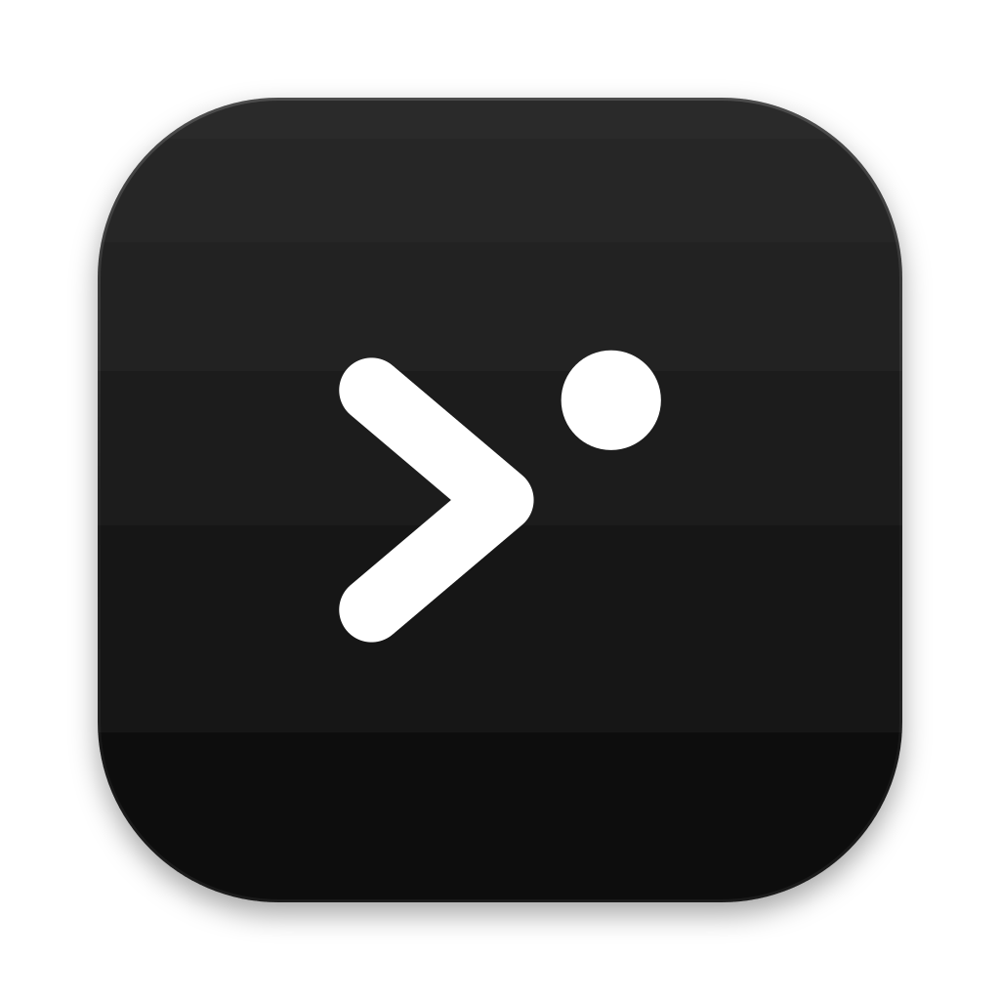

<p align="center">
  
</p>

<h1 align="center">Cue</h1>

<p align="center">
  <a href="https://github.com/haikelz/cue/actions/workflows/test.yml"></a>
</p>

A macOS menubar app for people who run many coding agents at once. Cue lists your Claude Code, Codex and Amp sessions with their status and last reply, and you send any of them its next prompt without hunting for its terminal window. It notifies you, with Amp's sounds, when a session finishes or needs you, and ⌃⌥Space opens it from any app.

<p align="center">
  
</p>

| | Claude Code | Codex | Amp |
| --- | --- | --- | --- |
| Status from | Hooks | Hooks | Cue's Amp plugin |
| Prompt delivery | Typed into the iTerm2 tab, WezTerm pane, kitty window or tmux pane, behind safety checks | `codex queue` | The plugin appends it to the thread |
| Send while the agent works | No | Yes, queued | Yes, queued |
| Terminals | iTerm2, WezTerm, kitty, or any terminal through tmux | Any | Any |
| Open button | Yes | Yes, for the one Codex running in that folder | Yes |

## Requirements

- macOS 14 or later, and iTerm2, WezTerm, kitty (with remote control on) or tmux for Claude Code
- `jq` (macOS 15 includes it), and Swift 6 to build from source (the Xcode Command Line Tools are enough)
- Any of: Claude Code 2.1.285+, Codex CLI 0.160+, Amp CLI

## Install

Download `cue-<version>.zip` from [Releases](https://github.com/haikelz/cue/releases), unzip it, and run `./install.sh` in that folder. The release app is built for Apple silicon. To build from source instead, run the same script in a clone:

```sh
./install.sh
```

The script installs `~/Applications/Cue.app`, wires in each agent you have installed (hooks for Claude Code and Codex, a plugin for Amp), and launches the app. It backs up every settings file it touches, keeping the last three backups, and it migrates a Claude Relay install.

Then:

- **Codex:** open `codex`, run `/hooks`, and trust Cue's hooks. Codex skips hooks you haven't trusted.
- **Amp:** in open Amp windows, run `plugins: reload` from the command palette, or restart Amp.
- **First start:** macOS asks whether Cue may send notifications. Click Allow. Cue also adds itself to your login items; turn that off in its gear menu.
- **First Send to Claude Code in iTerm2:** macOS asks whether Cue may control iTerm2. Click Allow. tmux and WezTerm need no permission.
- **kitty:** add `allow_remote_control socket-only` and `listen_on unix:/tmp/kitty` to `kitty.conf`, then restart kitty.

## Documentation

| Guide | For |
| --- | --- |
| [User guide](docs/user-guide.md) | The popover, every row message, notifications, permissions, troubleshooting |
| [Architecture](docs/architecture.md) | Hooks, the Amp plugin, session files, each agent's delivery path |
| [Development](docs/development.md) | Building, testing, debugging, and what to re-check when an agent updates |

## Uninstall

```sh
./uninstall.sh
```

The script removes Cue's hooks and plugin, keeps every other hook, takes Cue out of your login items, and deletes the app. Session files stay in `~/.cue` until you delete them.

The Claude, Codex and Amp logos are trademarks of Anthropic, OpenAI and Amp. Cue shows them only to mark which agent a session belongs to.
