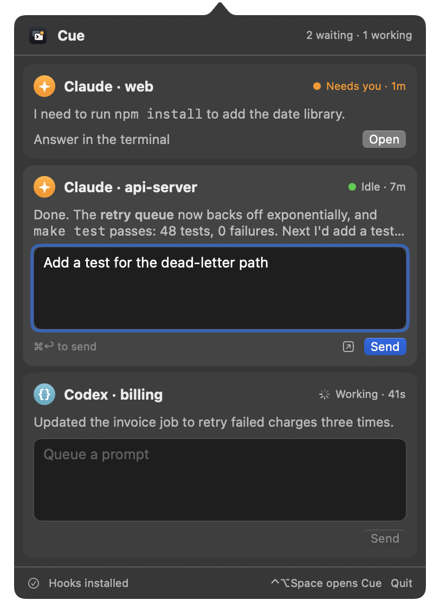

# Cue

A macOS menubar app for people who run many coding agents at once. Cue lists your Claude Code, Codex and Amp sessions with their status and last reply, and you send any of them its next prompt without hunting for its terminal window. Press ⌃⌥Space from any app to open it.

<p align="center">
  
</p>

| | Claude Code | Codex | Amp |
| --- | --- | --- | --- |
| Status from | Hooks | Hooks | Cue's Amp plugin |
| Prompt delivery | Typed into the iTerm2 tab or tmux pane, behind safety checks | `codex queue` | The plugin appends it to the thread |
| Send while the agent works | No | Yes, queued | Yes, queued |
| Terminals | iTerm2, or any terminal through tmux | Any | Any |
| Open button | Yes | No | Yes, in iTerm2 |

## Requirements

- macOS 14 or later, and iTerm2 or tmux for Claude Code
- `jq`, and Swift 6 (the Xcode Command Line Tools are enough)
- Any of: Claude Code 2.1.285+, Codex CLI 0.160+, Amp CLI

## Install

```sh
./install.sh
```

The script builds `~/Applications/Cue.app`, wires in each agent you have installed (hooks for Claude Code and Codex, a plugin for Amp), and launches the app. It backs up every settings file it touches, keeping the last three backups, and it migrates a Claude Relay install.

Then:

- **Codex:** open `codex`, run `/hooks`, and trust Cue's hooks. Codex skips hooks you haven't trusted.
- **Amp:** in open Amp windows, run `plugins: reload` from the command palette, or restart Amp.
- **First Send to Claude Code in iTerm2:** macOS asks whether Cue may control iTerm2. Click Allow. tmux needs no permission.

## Documentation

| Guide | For |
| --- | --- |
| [User guide](docs/user-guide.md) | The popover, every row message, notifications, permissions, troubleshooting |
| [Architecture](docs/architecture.md) | Hooks, the Amp plugin, session files, each agent's delivery path |
| [Development](docs/development.md) | Building, testing, debugging, and what to re-check when an agent updates |

## Uninstall

```sh
./uninstall.sh
```

The script removes Cue's hooks and plugin, keeps every other hook, and deletes the app. Session files stay in `~/.cue` until you delete them.
