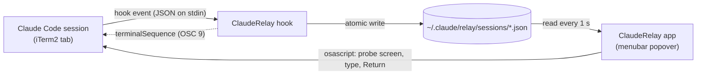
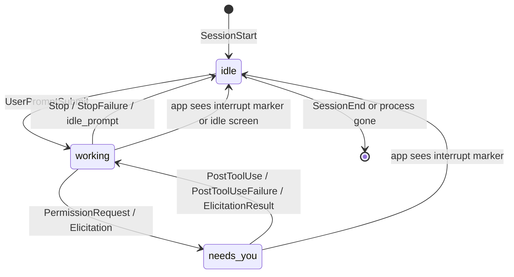

# Architecture

Claude Relay has no server and no socket. Claude Code hooks write one JSON file per session, the menubar app reads that folder, and the app types prompts back into iTerm2 tabs through AppleScript.



One binary does all of it. `main.swift` picks the mode before AppKit loads, which keeps a hook run near 6 ms:

| Invocation | Mode |
| --- | --- |
| `ClaudeRelay` | Menubar app |
| `ClaudeRelay hook` | Handle one hook event from stdin |
| `ClaudeRelay send <session-id> <text>` | The app's send path from the command line |
| `ClaudeRelay selftest` | Asserts for the safety-critical pure functions |

## Session tracking

### Hooks

`install.sh` registers `ClaudeRelay hook` in exec form (no shell) with a 5-second timeout:

```json
{ "type": "command", "command": "~/Applications/ClaudeRelay.app/Contents/MacOS/ClaudeRelay", "args": ["hook"], "timeout": 5 }
```

for these events: `SessionStart`, `UserPromptSubmit`, `PostToolUse`, `PostToolUseFailure`, `PermissionRequest`, `Elicitation`, `ElicitationResult`, `Stop`, `StopFailure`, `SessionEnd`, and `Notification` with matcher `idle_prompt`.

Hook mode never fails a hook: it exits 0 on any error, logs to `~/.claude/relay/hook.log`, and prints nothing except the notification JSON on `Stop` and `StopFailure`.

### Status rules

| Hook event | Status written | Other effect |
| --- | --- | --- |
| `SessionStart` | `idle`, unless `source` is `compact` | Compaction can run mid-turn, so it keeps the status (or `working` for a new file) |
| `UserPromptSubmit` | `working` | Stamps `last_prompt_at`, which confirms a send |
| `PostToolUse`, `PostToolUseFailure`, `ElicitationResult` | `working`, if not already | No write while working, which keeps the hot path cheap |
| `PermissionRequest`, `Elicitation` | `needs_you` | Fires before the dialog draws |
| `Stop` | `idle` | Stores the first 500 characters of `last_assistant_message`; returns the notification |
| `StopFailure` | `idle` | Stores `API error: <type>`; returns the notification |
| `Notification` (`idle_prompt`) | `idle`, from `working` | A second idle signal |
| `SessionEnd` | File deleted | Row disappears |

Events that carry `agent_id` come from subagents and change nothing. Every write refreshes the terminal target and process facts, so a session started before the install registers on its next event.



### The session file

`~/.claude/relay/sessions/<session_id>.json`, mode 0600, in a folder with mode 0700:

| Field | Source | Use |
| --- | --- | --- |
| `session_id` | Hook input | File name and identity |
| `cwd` | Hook input | Project name in the row |
| `status` | Status rules | `working`, `idle` or `needs_you` |
| `last_message` | `Stop` or `StopFailure` | Row preview and notification text |
| `last_prompt_at` | `UserPromptSubmit` time | Send confirmation |
| `updated_at` | Every write | Badge time, recovery checks |
| `claude_pid`, `claude_start` | The `claude` process above the hook | Liveness; the start time guards against PID reuse |
| `tty` | That process's controlling terminal | Matches the iTerm2 tab before typing |
| `iterm_session_id` | `ITERM_SESSION_ID`, dropped when `TMUX` is set | The tab to type into |
| `transcript_path` | Hook input | Interrupt detection |

Times are Unix seconds. Hook processes run in their own session without a terminal, so hook mode walks parent processes (`claude → hook` or `claude → sh → hook`) to find Claude and reads its PID, start time and tty with `sysctl`.

### Recovery without a hook event

Claude Code fires no hook when you press Esc or deny a permission. The app covers both:

- **Interrupt marker.** When a row isn't idle and the transcript's last message entry is `[Request interrupted by user…]`, written after the row's last update, the app sets the row idle. Claude Code appends metadata entries after the marker, so the app reads the last `user` or `assistant` entry, not the last line.
- **Screen probe.** Esc pressed before Claude writes anything puts the prompt back in the input box and leaves no marker. When the popover opens, the app probes each row that has stayed at `working` for 15 seconds, with no file or transcript change. An idle input box with no spinner sets it idle.

The app also deletes a session file when its PID no longer runs, or runs with a different start time. That covers closed tabs and crashes, which skip `SessionEnd`.

## The send pipeline

`Delivery.send` turns a prompt into keystrokes. Each step can refuse, and nothing reaches the tab until the checks pass.

1. **Sanitize.** Strip C0 and C1 control characters (line breaks stay), DEL, zero-width, bidi, tag and variation-selector characters. Turn tabs into spaces, since Tab completes in Claude Code. Add a space after a trailing `\`, since `\` then Return inserts a line break.
2. **Process checks.** Re-read the session file: it must say `idle`. The PID must run with the recorded start time, as its terminal's foreground process group, not stopped. Its tty must match the recorded one.
3. **Screen checks.** Read the tab's tty and visible text with AppleScript. The tty must match. Claude's input box must be on screen: a rule line of `─`, a line starting with `❯` (or `!` in shell mode) in column 0, more input lines, a rule line. No spinner may sit in the six lines above the box, and vim mode must not be in NORMAL.
4. **Clear the box.** If the box holds text, send Ctrl+U once per box line. A draft stays recoverable with Ctrl+Y; a grayed-out suggestion vanishes.
5. **Type.** Send the prompt in 200-character chunks, 150 ms apart, with each line break as ESC + CR (Option+Return). No Return yet.
6. **Check again.** Repeat steps 2 and 3, then confirm the box's last line is the end of the prompt.
7. **Return.** Press Return in a separate AppleScript call that re-checks the tty.
8. **Confirm.** The app waits for `last_prompt_at` at or after the send start, with a 5-second deadline that starts once typing ends. Prompts starting with `/` or `!` skip this step.

A refusal before step 5 leaves the tab untouched. A failure from step 5 on copies the prompt to the clipboard and says so on the row.

The column-0 rule matters: dialog options such as ` ❯ 1. Yes` are indented, so a dialog can't pass for the input box.

### Why these numbers

| Constant | Value | Reason |
| --- | --- | --- |
| Chunk size and gap | 200 characters, 150 ms | Claude Code treats input that arrives in one burst as a paste and wraps it as data. A 900-character burst, or 100-character chunks 20 ms apart, arrived as `<pasted_content>`; 200-character chunks 150 ms apart arrived as typed text |
| Confirmation deadline | 5 s after typing ends | Covers `UserPromptSubmit` latency without making a failed send wait long |
| Stale-working probe | 15 s quiet | Long enough that a working session has written to its transcript |
| Poll interval | 1 s | Rows and the count stay current; reading a dozen small files costs nothing |
| Last message | 500 characters | Enough for the preview and the notification |
| AppleScript timeout | 60 s (10 s for probes and Open) | Leaves time for the first-run Automation consent dialog |
| Lock wait | 50 tries, 10 ms apart | A stuck lock holder can't hang a hook or the app |
| PID start-time tolerance | 0.01 s | Survives float rounding, catches PID reuse |

## Concurrency

- **Writes** go to a temp file and `rename(2)`, so readers never see half a file.
- **One lock** (`~/.claude/relay/.lock`, `flock`) serializes every read-modify-write: hooks, the app's idle corrections and its stale-file deletes. Parallel tool calls fire hooks at the same moment, and the lock keeps their updates. The lock is global; hook runs take about a millisecond, so contention stays invisible below hundreds of sessions.
- **AppleScript calls** block, so the app runs them one at a time on a serial dispatch queue, off the main thread. Probes for the same row don't stack.

## Settings install and uninstall

Live Claude Code sessions reload `~/.claude/settings.json` when it changes, so neither script writes it in place. Each one backs it up, writes a temp file in the same folder with `jq`, validates it, keeps the file mode, and renames it over the original. `install.sh` skips events that already hold Relay's hook. `uninstall.sh` removes handlers whose command is Relay's exact path and keeps any other handler in the same group. Both refuse to touch a symlinked settings file.

## Files

| Path | Contents |
| --- | --- |
| `~/Applications/ClaudeRelay.app` | The app, ad-hoc signed, `LSUIElement` (no Dock icon) |
| `~/.claude/relay/sessions/*.json` | One file per session |
| `~/.claude/relay/hook.log` | Hook errors |
| `~/.claude/relay/.lock` | The lock file |
| `~/.claude/settings.json.relay-backup-*` | Settings backups from install and uninstall |

Set `RELAY_DIR` to move `~/.claude/relay` elsewhere; the tests use it.
