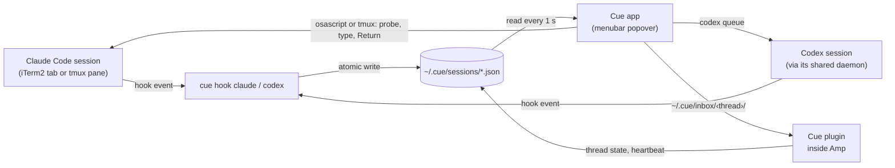
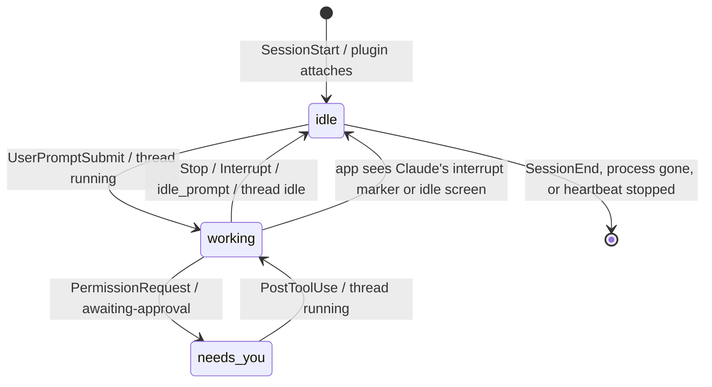
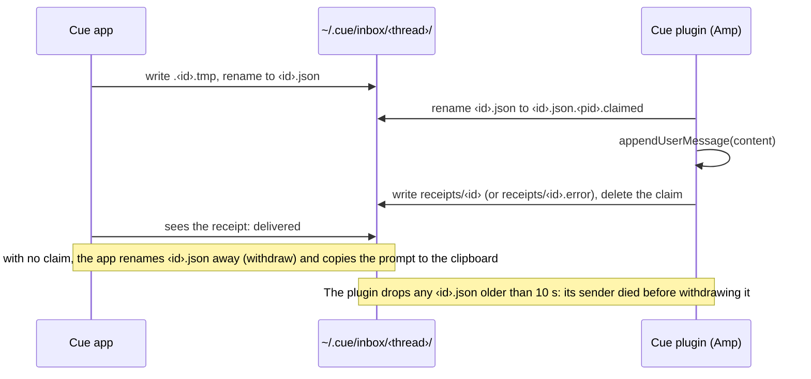

# Architecture

Cue has no server and no socket. Each agent reports into one folder of JSON files, the menubar app reads that folder, and each agent takes prompts through its own channel.

One binary does all of it. `main.swift` picks the mode before AppKit loads, which keeps a hook run near 6 ms:

| Invocation | Mode |
| --- | --- |
| `cue` | Menubar app |
| `cue hook claude` | Handle one Claude Code hook event from stdin |
| `cue hook codex` | Handle one Codex hook event from stdin; always prints JSON |
| `cue send <session-id> <text>` | The app's send path from the command line |
| `cue selftest` | Asserts for the safety-critical pure functions |
| `cue codex-health [cue path]` | The footer's Codex hook check: `ok`, the warning, or `no answer` |

## Agents at a glance

| | Claude Code | Codex | Amp |
| --- | --- | --- | --- |
| Reports through | Hooks in `~/.claude/settings.json` | Hooks in `~/.codex/hooks.json` | `~/.config/amp/plugins/cue.ts` |
| Hooks run in | The session's `claude` process | Codex's shared app-server daemon | (plugin, inside the Amp process) |
| Delivery | Typed into the iTerm2 tab or tmux pane | `codex queue` | Inbox file, appended by the plugin |
| Confirmation | `last_prompt_at` within 5 s | `codex queue` exit 0: "Sent", or "Queued" during a turn | A receipt from the plugin |
| Liveness | PID and start time | `SessionEnd`, a newer session in the same folder, or 24 h without change | Heartbeat younger than 30 s; the file goes after an hour |
| Open | The iTerm2 tab, or the tmux pane and its terminal app | No; the tab is unknown | Yes, from the plugin's `ITERM_SESSION_ID` |

## Session tracking

### Claude Code hooks

`install.sh` registers `cue hook claude` in exec form (no shell) with a 5-second timeout for `SessionStart`, `UserPromptSubmit`, `PostToolUse`, `PostToolUseFailure`, `PermissionRequest`, `Elicitation`, `ElicitationResult`, `Stop`, `StopFailure`, `SessionEnd`, and `Notification` with matcher `idle_prompt`.

Hook mode never fails a hook: it exits 0 on any error, logs to `~/.cue/hook.log`, and prints nothing except the notification JSON on `Stop` and `StopFailure`.

### Codex hooks

`install.sh` appends one group per event to the end of each list in `~/.codex/hooks.json`, with the command string `'<abs path>/cue' hook codex` (Codex handlers take no `args`) and a 3-second timeout, the cap Codex sets for some events. A reinstall updates Cue's own entries in place. Appending matters: Codex records hook trust by position, so inserting in the middle would invalidate the trust of your other hooks. Codex runs a hook only after you trust it in `/hooks`.

Codex runs hooks in its shared app-server daemon, so a hook knows the session id but not its tab or terminal process. Codex expects JSON on stdout for `Stop`; `cue hook codex` prints `{}` for every event. It skips sessions whose rollout file names an originator other than `codex-tui`, and sessions with no rollout at all (Codex's own background sessions, such as memory upkeep), which keeps `codex exec` runs and background work out of the list. When a new interactive session starts, it removes the idle Codex rows in the same folder: `/clear`, `/new` and `/resume` start a new session in the same TUI, and the old thread would otherwise stay sendable for 30 minutes with nobody watching it.

Codex keys hook trust by list position and a hash, so another tool that reorders `hooks.json` can silently untrust Cue's hooks. When the popover opens and `hooks.json` or `config.toml` changed since the last answer, the app starts `codex app-server` and asks `hooks/list`, which reports each hook's `trustStatus` and `enabled`. The footer warns when fewer than seven Cue hooks are listed, or when one isn't trusted or enabled. The call runs on a background queue, takes about two seconds, and stays quiet when Codex answers with an error or says nothing within 10 seconds: the API is marked experimental.

### Status rules

| Event | Status written | Other effect |
| --- | --- | --- |
| `SessionStart` | `idle`, unless `source` is `compact` | Compaction can run mid-turn, so it keeps the status (or `working` for a new file) |
| `UserPromptSubmit` | `working` | Stamps `last_prompt_at` and, for Codex, the turn id |
| `PostToolUse`, `PostToolUseFailure`, `ElicitationResult` | `working`, if not already | No write while working, which keeps the hot path cheap |
| `PermissionRequest`, `Elicitation` | `needs_you` | Fires before the dialog draws |
| `Stop` | `idle` | Stores the first 4,000 characters of `last_assistant_message`; Claude also gets the notification |
| `StopFailure` (Claude) | `idle` | Stores `API error: <type>`; returns the notification |
| `Interrupt` (Codex) | `idle` | Esc in Codex |
| `Notification` (`idle_prompt`, Claude) | `idle`, from `working` | A second idle signal |
| `SessionEnd` | File deleted | Row disappears |

Claude events that carry `agent_id` come from subagents and change nothing. Codex subagents report under the parent's session id without `agent_id`, so once a Codex row is idle, events from a turn other than the last `UserPromptSubmit` are ignored.

### The Amp plugin

`~/.config/amp/plugins/cue.ts` starts nothing when it loads, because `amp plugins list` loads plugins in a short-lived process. It attaches to `amp.activeThread`, the thread you have open in that Amp window, and moves with it when you switch threads. Amp's observables report later values only, so the plugin also reads `activeThread.current` and the thread's `state.get()` when it loads:

- It follows the thread's state and writes the session file: `running` to working, `awaiting-approval` to needs_you, `idle` to idle, `error` to idle with "Error".
- On `agent.end`, it stores the last assistant text and posts the finish notification by writing OSC 9 to the tty of the Amp process above it. It looks the tty up on first attach and writes without blocking, so a paused terminal can't stall it.
- It records the Amp process id, `ITERM_SESSION_ID` and `PWD` from its environment, and rewrites a `heartbeat` every 5 seconds. The app hides the row after 30 seconds of silence, refuses a send after 15, and deletes the file after an hour, so it never races a plugin that resumes.
- Every second, it drains its own thread's inbox (below). When it stops, it deletes its session file, provided the file still names its Amp process: a second window on the same thread keeps the row.

### The session file

`~/.cue/sessions/<session id>.json`, mode 0600, in a folder with mode 0700:

| Field | Source | Use |
| --- | --- | --- |
| `session_id` | Hook input or Amp thread id | File name and identity |
| `agent` | `claude`, `codex` or `amp` | Delivery path, row label |
| `cwd` | Hook input, or the plugin's `PWD` | Project name in the row |
| `status` | Status rules | `working`, `idle` or `needs_you` |
| `last_message` | `Stop`, `StopFailure`, `agent.end` | Row preview and notification text |
| `last_prompt_at` | `UserPromptSubmit` or `agent.start` time | Send confirmation |
| `updated_at` | Each status change | Badge time, recovery checks |
| `pid`, `pid_start` | Claude: the `claude` process above the hook; Amp: the Amp process | Liveness; the start time guards against PID reuse |
| `tty` | Claude's controlling terminal | Matches the iTerm2 tab or tmux pane before typing |
| `iterm_session_id` | `ITERM_SESSION_ID`, dropped when `TMUX` is set | The tab to type into, and Open |
| `tmux_socket`, `tmux_pane` | Claude inside tmux: the socket part of `$TMUX`, and `$TMUX_PANE` | The pane to type into, and Open |
| `transcript_path` | Hook input | Claude interrupt detection, Codex originator and activity |
| `turn_id` | Codex `UserPromptSubmit` | Filters Codex subagent events |
| `heartbeat` | Amp plugin | Amp liveness |

Times are Unix seconds. Claude rows key drafts by iTerm2 tab or tmux pane, so a draft survives `/clear`. Codex and Amp rows key by session id, since several of their threads can share a tab.

### Recovery without a hook event (Claude Code)

Claude Code fires no hook when you press Esc or deny a permission. The app covers both:

- **Interrupt marker.** When a Claude row isn't idle and the transcript's last message entry is `[Request interrupted by user…]`, written after the row's last update, the app sets the row idle. Claude Code appends metadata entries after the marker, so the app reads the last `user` or `assistant` entry, not the last line.
- **Screen probe.** Esc pressed before Claude writes anything puts the prompt back in the input box and leaves no marker. When the popover opens, the app probes each Claude row that has stayed at `working` for 15 seconds. An idle input box with no spinner sets it idle.

Codex reports Esc through its `Interrupt` hook, and Amp through its thread state, so neither needs recovery.

## Delivery

### Claude Code: typing into the terminal

`Delivery.typeIntoClaude` turns a prompt into keystrokes for the session's iTerm2 tab, or for its tmux pane when Claude runs inside tmux. Each step can refuse, and nothing reaches the terminal until the checks pass.

1. **Sanitize.** Strip C0 and C1 control characters (line breaks stay), DEL, zero-width, bidi, tag and variation-selector characters. Turn tabs into spaces, since Tab completes in Claude Code. Add a space after a trailing `\`, since `\` then Return inserts a line break.
2. **Process checks.** Re-read the session file: it must say `idle`. The PID must run with the recorded start time, as its terminal's foreground process group, not stopped. Its tty must match the recorded one.
3. **Screen checks.** Read the tab's tty and visible text with AppleScript, or the pane's with `tmux display-message` and `tmux capture-pane`. The tty must match. Claude's input box must be on screen: a rule line of `─`, a line starting with `❯` (or `!` in shell mode) in column 0, more input lines, a rule line. No spinner may sit in the six lines above the box, and vim mode must not be in NORMAL.
4. **Clear the box.** If the box holds text, send Ctrl+U once per box line. A draft stays recoverable with Ctrl+Y; a grayed-out suggestion vanishes.
5. **Type.** Send the prompt in 200-character chunks, 150 ms apart, with each line break as ESC + CR (Option+Return). No Return yet. tmux gets the same bytes through `send-keys -H`; a text argument ending in `;` would parse as a tmux command separator.
6. **Check again.** Repeat steps 2 and 3, then confirm the box's last line is the end of the prompt.
7. **Return.** Press Return in a separate call that re-checks the tty.
8. **Confirm.** The app waits for `last_prompt_at` at or after the send start, with a 5-second deadline that starts once typing ends. Prompts starting with `/` or `!` skip this step.

A refusal before step 5 leaves the terminal untouched. A failure from step 5 on copies the prompt to the clipboard and says so on the row. The column-0 rule matters: dialog options such as ` ❯ 1. Yes` are indented, so a dialog can't pass for the input box.

tmux runs the same steps with the tmux CLI, so Ghostty, Kitty, WezTerm and Terminal.app all work, and no macOS permission is involved. Two tmux states refuse before every step: copy mode, where tmux reads keys as its own commands while `capture-pane` still shows Claude's screen, and `synchronize-panes`, where tmux copies keys into every pane of the window. The app uses the `tmux` path from `~/.cue/config.json`, then `/opt/homebrew/bin` and `/usr/local/bin`. Open selects the pane's window and pane, then walks up from the tmux client you used last to the terminal app that hosts it and activates that app. iTerm2 runs shells under its `iTermServer` helper, whose parent is launchd, so meeting that helper means iTerm2.

### Codex: `codex queue`

`Delivery.queueToCodex` runs the absolute `codex` path saved in `~/.cue/config.json` as `codex queue --thread=<id> --message=<prompt>`. The `=` forms keep a prompt that starts with `-` from parsing as a flag. Cue passes the PATH that install.sh captured, because `codex queue` may start Codex's daemon, and the daemon runs your other Codex hooks with that PATH. Exit 0 means Codex accepted the prompt, so the row shows "Sent", or "Queued" during a turn. Cue doesn't also wait for `UserPromptSubmit`: that could only turn a slow start into "Not confirmed" and a duplicate send.

### Amp: the inbox, at most once

A rename can succeed for one process only, so when two Amp windows show the same thread, one delivers. The app's withdraw is a rename too: if the plugin claimed the file first, the withdraw fails and the app waits for the receipt, up to a minute. The plugin writes the receipt only after `appendUserMessage` resolves, and writes it through a temp file. A prompt therefore arrives once or not at all, never twice or late.

The plugin checks each inbox file before trusting it: a name of the form `<uuid>.json`, a regular file (no symlinks) owned by you, mode 0600, under 64 KB. The app caps a prompt at 60 KB so it always fits. The thread id comes from the folder, never from the file. Any process running as you can still write to the inbox; that is the same trust boundary as running `codex queue` yourself.

### Why these numbers

| Constant | Value | Reason |
| --- | --- | --- |
| Chunk size and gap (Claude) | 200 characters, 150 ms | Claude Code treats input that arrives in one burst as a paste and wraps it as data. A 900-character burst, or 100-character chunks 20 ms apart, arrived as `<pasted_content>`; 200-character chunks 150 ms apart arrived as typed text |
| Confirmation deadline (Claude) | 5 s after delivery | Covers `UserPromptSubmit` latency without making a failed send wait long |
| Amp claim deadline | 5 s, then up to 60 s for a receipt | The plugin polls every second; a claimed prompt may wait for Amp's own queue |
| Amp orphan cutoff | 10 s | Twice the app's withdraw deadline; an older file lost its sender |
| Amp heartbeat | Every 5 s; stale after 15 s for sends, 30 s for the row, file deleted after 1 h | Tolerates a busy event loop, notices a closed window quickly |
| Codex row expiry | 24 h without change | Codex sends `SessionEnd` after 30 unopened minutes; the expiry covers a lost one. A new interactive Codex session in a folder also retires that folder's idle Codex rows |
| Stale-working probe (Claude) | 15 s quiet | Long enough that a working session has written to its transcript |
| Poll interval | 1 s | Rows and the count stay current; reading a dozen small files costs nothing |
| Last message | 4,000 characters | Enough to read most replies in full; the row shows two lines until you click it |
| AppleScript timeout | 60 s (10 s for probes and Open) | Leaves time for the first-run Automation consent dialog |
| tmux timeout | 10 s | tmux answers in milliseconds; no consent dialog |
| `codex queue` timeout | 30 s | Covers a daemon cold start |
| Codex hook timeout | 3 s | Codex caps some events at 3 s; a hook run takes about 6 ms |
| Lock wait | 50 tries, 10 ms apart | A stuck lock holder can't hang a hook or the app |

## The menubar app

An `NSStatusItem` with an `NSPopover` holds the UI; SwiftUI's `MenuBarExtra` can't open from code, which the hotkey needs. ⌃⌥Space comes from Carbon's `RegisterEventHotKey`, which needs no Accessibility permission. Each time the popover opens, the app re-sorts the rows and puts the cursor in the first row you can type in. Only the row being edited owns ⌘Return, and one reply expands at a time.

## Concurrency

- **Writes** go to a temp file and `rename(2)`, so readers never see half a file. The Amp plugin writes the same way.
- **One lock** (`~/.cue/.lock`, `flock`) serializes every read-modify-write by hooks and the app. The Amp plugin is the only writer of its session file, so it doesn't take the lock.
- **Blocking calls** (AppleScript, tmux, `codex queue`) run one at a time on a serial dispatch queue, off the main thread. Probes for the same row don't stack. The Codex `hooks/list` check runs on a separate background queue, so it never delays a send.

## Settings install and uninstall

Live sessions reload `~/.claude/settings.json` and `~/.codex/hooks.json` when they change, so neither script writes them in place. Each one backs the file up (keeping the last three backups), writes a temp file in the same folder with `jq`, validates it, keeps the file mode, and renames it over the original. Both refuse to touch a symlinked settings file. `install.sh` wires each agent only when it's installed: `~/.claude` for Claude Code, `~/.codex` for Codex, the `amp` command for Amp.

`install.sh` builds the new app bundle beside the old one and swaps them with renames. It replaces Claude Relay's hooks with Cue's in one write, then deletes ClaudeRelay.app and `~/.claude/relay`, so live sessions never call a missing binary. A second install changes nothing. `uninstall.sh` removes the handlers whose command is Cue's and keeps any other handler in the same group; removing Cue's Codex groups can make Codex ask you to re-review hooks listed after them.

## Files

| Path | Contents |
| --- | --- |
| `~/Applications/Cue.app` | The app, ad-hoc signed, `LSUIElement` (no Dock icon); `Contents/Resources` holds the app icon and the menubar mark |
| `~/.config/amp/plugins/cue.ts` | The Amp plugin |
| `~/.cue/sessions/*.json` | One file per session |
| `~/.cue/inbox/‹thread›/` | Amp prompts waiting for the plugin, and its receipts |
| `~/.cue/config.json` | The `codex` and `tmux` paths and PATH from install time |
| `~/.cue/hook.log` | Hook errors |
| `~/.cue/.lock` | The lock file |
| `*.cue-backup-*` | Settings backups beside `~/.claude/settings.json` and `~/.codex/hooks.json`, the last three of each |

Set `CUE_DIR` to move `~/.cue` elsewhere; the tests use it.
